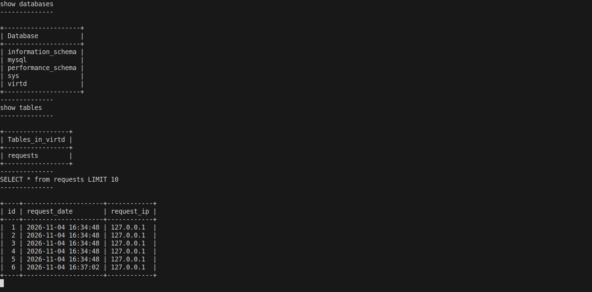

# Docker Compose: FastAPI, MySQL и прокси

## Конфигурация

- `compose.yaml` подключает `proxy.yaml` через `include`.
- `proxy.yaml` содержит Nginx, HAProxy и определение bridge-сети `backend`
  с подсетью `172.20.0.0/24`. Параметр `name: backend` задаёт точное имя
  сети Docker, без префикса проекта.
- `web` собирается из `Dockerfile.python`, имеет адрес `172.20.0.5`
  и политику `restart: always`.
- `db` использует `mysql:8`, адрес `172.20.0.10`, политику
  `restart: on-failure` и именованный том `mysql_data`.
- Все пароли, имя БД и пользователь берутся из существующего `.env`.
  Значения секретов в Compose не продублированы.
- `DB_HOST=db`: имя сервиса MySQL равно `db`, а `web` является клиентом БД.
- `web` запускается после успешного SQL healthcheck базы данных.

Схема запроса:

```text
curl 127.0.0.1:8090
  -> Nginx (host network, 8090)
  -> HAProxy (127.0.0.1:8080 -> bridge, 8080)
  -> web (172.20.0.5:5000)
  -> db (172.20.0.10:3306)
```

Директива `include` требует Docker Compose 2.20.0 или новее:
[документация Docker](https://docs.docker.com/reference/compose-file/include/).
Отдельно определять `networks.backend` в `compose.yaml` не требуется:
она импортируется из `proxy.yaml`.

## Запуск

Выполнить из корня проекта на Linux с работающим Docker Engine:

```bash
docker compose version
docker compose config --quiet
docker compose up -d --build --wait --wait-timeout 240
docker compose ps
curl -L http://127.0.0.1:8090
```

Если Docker недоступен текущему пользователю, добавить `sudo` перед
командами `docker`. Не публиковать вывод полного `docker compose config`:
он содержит интерполированные пароли из `.env`.

Для диагностики:

```bash
docker ps -a
docker compose logs --tail=100 web db reverse-proxy ingress-proxy
docker logs "$(docker compose ps -q web)"
```

## Интерактивная проверка SQL

Подключиться к MySQL без печати пароля в истории хоста:

```bash
DB_CONTAINER=$(docker compose ps -q db)
docker exec -ti "$DB_CONTAINER" sh -c \
  'exec mysql -uroot -p"$MYSQL_ROOT_PASSWORD"'
```

Пароль раскрывается внутри контейнера из его переменной окружения.
В аргументах MySQL нет пробела между `-u` и `root`, а также между
`-p` и значением пароля. Для постоянной эксплуатации предпочтительнее
не передавать пароль аргументом; здесь сохранён способ из учебного задания.

В клиенте выполнить по очереди:

```sql
show databases;
use virtd;
show tables;
SELECT * from requests LIMIT 10;
exit;
```

Если значение `MYSQL_DATABASE` в вашем `.env` отличается от `virtd`,
использовать фактическое имя базы.

Для повторяемого вывода команд и результатов в терминал:

```bash
bash scripts/show-sql.sh
```

Скрипт делает настоящий HTTP-запрос и выполняет SQL в контейнере,
а не выводит заранее сохранённые результаты. Он использует `sudo`
для Docker и требует терминал, поскольку подключается с `-ti`.

## Выполненная проверка

Проверка проведена 4 ноября 2026 года в локальном Docker Engine песочницы:

- Образ действительно собран из двухстадийного `Dockerfile.python`.
- `docker compose up -d --build --wait` завершился успешно.
- Пять последовательных HTTP-запросов вернули время и IP `127.0.0.1`.
- В `virtd.requests` появились соответствующие записи.
- `web` и `db` имеют статус `healthy` и счётчики перезапусков `0`.
- Подтверждены адреса `172.20.0.5` и `172.20.0.10`.
- `python -m pip check` внутри `web` не обнаружил нарушенных зависимостей.

Скриншот реального SQL-вывода после дополнительного HTTP-запроса:



В тестовой песочнице потребовались два обхода ограничений окружения:
iptables-legacy и переменная демона `DOCKER_INSECURE_NO_IPTABLES_RAW=1`
из-за отсутствия поддержки таблицы `raw` в ядре. Это не настройки проекта
и не рекомендации для обычного или производственного сервера.
Описание ограничения безопасности:
[Docker Engine 28 release notes](https://docs.docker.com/engine/release-notes/28/).

Из-за TLS-прокси песочницы первичная сборка выполнена с доверенным CA
через необязательный BuildKit secret:

```bash
sudo docker build \
  --secret id=pip_ca,src=/etc/ssl/certs/ca-certificates.crt \
  -f Dockerfile.python \
  -t shvirtd-example-python-web .
```

Затем выполнен обычный `docker compose up -d --build --wait`.
Вне такого TLS-прокси секрет не нужен: Dockerfile работает без него.
Проверка TLS не отключалась, сертификат не копируется в финальный образ.

## Остановка

После проверки и сохранения скриншота:

```bash
docker compose down
docker compose ps -a
```

Том MySQL сохраняется. Не добавлять `--volumes`, если требуется сохранить
учебную БД для следующего запуска.
