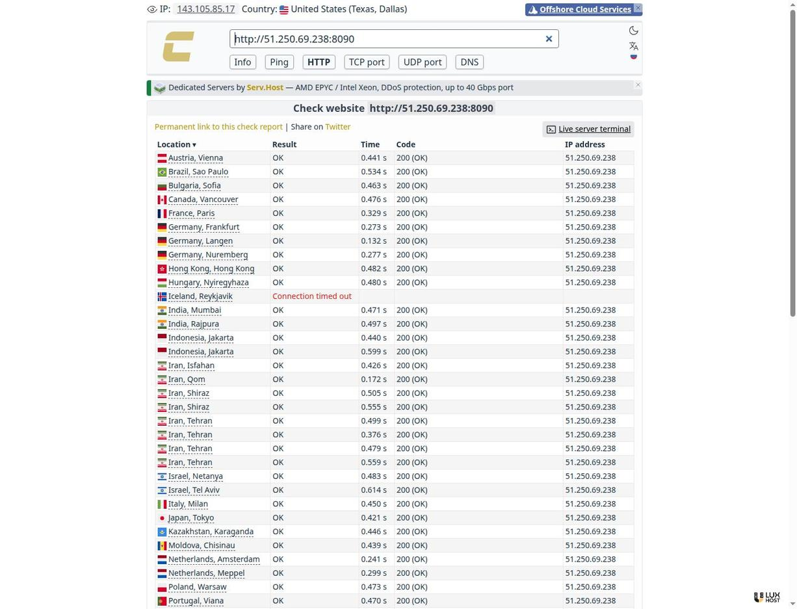
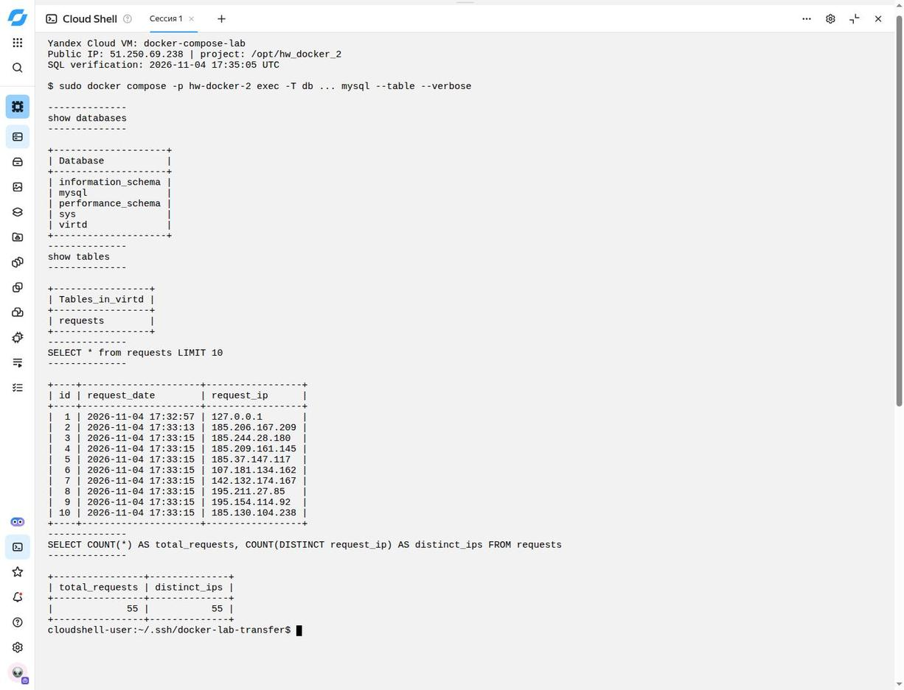
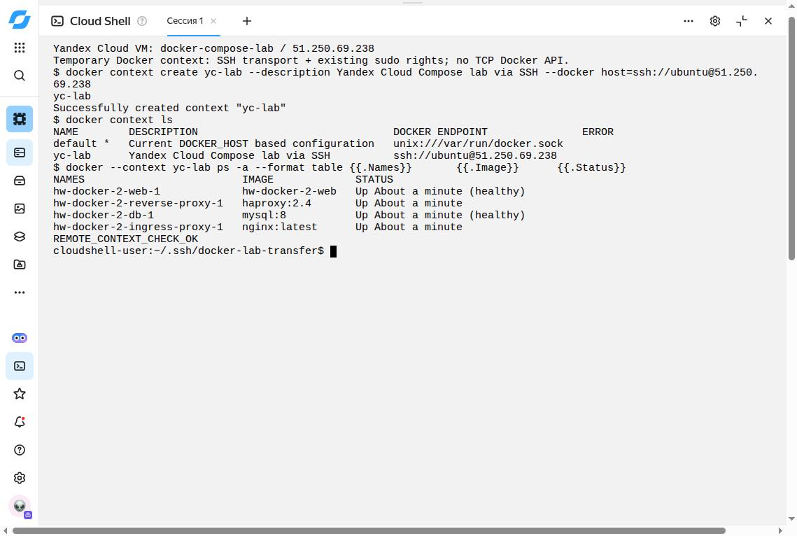

# Развёртывание проекта в Yandex Cloud

## Статус

4 ноября 2026 года создана ВМ `docker-compose-lab` в Yandex Cloud.
Внешний адрес: `51.250.69.238`, внутренний: `10.129.0.34`.
SSH-подключение выполнено через Yandex Cloud Shell с проверкой ключа хоста.
На сервере успешно выполнен `scripts/deploy-yc.sh`, код завершения `0`:
Docker установлен, multistage-образ собран, весь Compose-проект запущен.
Работают `web`, `db`, `reverse-proxy` и `ingress-proxy`; `web` и `db`
прошли healthcheck.

Результат задания:

- Сервис: [http://51.250.69.238:8090](http://51.250.69.238:8090).
- Fork: [brg171171/hw_docker_2](https://github.com/brg171171/hw_docker_2).
- [Полный отчёт Check-Host](https://check-host.net/check-report/558cf370k342):
  **53 из 55 узлов получили HTTP 200**, Исландия (Reykjavik) и Румыния
  (Bucharest) завершились тайм-аутом. Это результат конкретного запуска,
  а не гарантия доступности из любой сети.
- Запрос MySQL после внешней проверки: **55 записей, 55 различных IP**.
- SQL-скриншот с облачного сервера:
  [`docs/yc-mysql-sql-requests.jpg`](docs/yc-mysql-sql-requests.jpg).
- Снимок HTTP-проверки:
  [`docs/yc-check-host-http.jpg`](docs/yc-check-host-http.jpg).
- Результаты всех 55 узлов:
  [`docs/check-host-http-2026-11-04.json`](docs/check-host-http-2026-11-04.json).
- Необязательный Docker SSH context проверен:
  [`docs/yc-docker-context.jpg`](docs/yc-docker-context.jpg).

Ранее сохранённый `docs/mysql-sql-requests.jpg` относится к локальной
песочнице. Для текущего облачного задания используется новый файл
`docs/yc-mysql-sql-requests.jpg`.

На облачной Ubuntu Docker первоначально отсутствовал: ветка установки
Docker CE проверена исполнением на созданной ВМ, а не только локальным
тестом на машине с уже установленным Docker.

## Облачная ВМ

Параметры созданного учебного стенда:

- Ubuntu 24.04 LTS, пользователь `ubuntu`, вход по SSH-ключу.
- Intel Ice Lake, 2 vCPU с гарантированной долей 20%, 2 ГиБ RAM,
  загрузочный HDD 20 ГиБ.
- Зона `ru-central1-a`, каталог `default` (`b1gjei4h3oc3g28tejmt`).
- ID ВМ: `fhmhipgb8ukrm63jtfmj`.
- Сеть `docker-lab-network`, подсеть `docker-lab-subnet-a` (`10.129.0.0/24`).
- Динамический публичный IPv4.
- Отдельная группа безопасности: входящий TCP 8090 из интернета,
  TCP 22 только с адреса управления, исходящий доступ для установки пакетов.
- Порты 3306, 5000 и 8080 не открываются в облачной группе безопасности.

Работа ВМ, диска и публичного адреса тарифицируется. По согласованию с
пользователем ВМ остаётся работающей после проверки; остановка или удаление
выполняются отдельно. Динамический внешний адрес может измениться после
остановки и повторного запуска ВМ.

Карточка созданной ВМ:
[docker-compose-lab](https://console.yandex.cloud/folders/b1gjei4h3oc3g28tejmt/compute/instance/fhmhipgb8ukrm63jtfmj/overview).

Инструкция по созданию:
[Yandex Cloud](https://yandex.cloud/ru/docs/compute/quickstart/quick-create-linux).

## SSH и запуск скрипта

Команды выполняются с управляющего компьютера, где находится SSH-ключ:

```bash
ssh -i ~/.ssh/yc_lab ubuntu@51.250.69.238
```

На Ubuntu-ВМ:

```bash
sudo cloud-init status --wait

curl --fail --silent --show-error --location \
  https://raw.githubusercontent.com/brg171171/hw_docker_2/main/scripts/deploy-yc.sh \
  --output /tmp/deploy-yc.sh

# Проверить скачанный код перед запуском с root.
less /tmp/deploy-yc.sh
bash -n /tmp/deploy-yc.sh
sudo bash /tmp/deploy-yc.sh
```

В остальных примерах `PUBLIC_IP` заменить на текущий адрес ВМ,
сейчас `51.250.69.238`; путь к ключу также заменить своим.
Для самостоятельного подключения необходимо разрешить в группе
безопасности TCP 22 со своего адреса `/32` и использовать соответствующий
ключ. Приватные ключи и реальные пароли в репозитории не публикуются.
Команда `cloud-init status --wait` выполняется, если `cloud-init`
установлен в выбранном образе.

Скрипт:

- На новой Ubuntu устанавливает Docker Engine и Compose plugin из официального
  репозитория, если Docker ещё не установлен; существующий runtime не удаляет.
- Проверяет Compose 2.20.0+ и наличие Buildx.
- Клонирует fork в `/opt/hw_docker_2`.
- При первом запуске заменяет примерные пароли из публичного `.env` случайными
  локальными значениями, сохраняя имена БД и пользователя.
- Сохраняет `.env` с правами `0600`, не выводит пароли и не коммитит их.
- При повторном запуске сохраняет пароли и том базы данных.
- Запускает проект с именем Compose `hw-docker-2`, включая оба прокси.
- Делает HTTP-запрос через порт 8090 и проверяет запись запроса в MySQL.

Установка Docker основана на
[официальной инструкции для Ubuntu](https://docs.docker.com/engine/install/ubuntu/).
Скрипт не создаёт облачную ВМ и не меняет её группу безопасности.
Он также не отключает TLS-проверку и не применяет обходы iptables из песочницы.

## Проверка извне

С управляющего компьютера:

```bash
curl --fail -L http://PUBLIC_IP:8090
```

В браузере открыть [Check-Host HTTP](https://check-host.net/check-http),
ввести `http://PUBLIC_IP:8090` и запустить проверку. После её завершения
сохранить ссылку на результат и скриншот.

Выполненная проверка:
[558cf370k342](https://check-host.net/check-report/558cf370k342).
Независимый запрос из Cloud Shell также вернул ответ приложения:

```text
"TIME: 2026-11-04 17:33:13, IP: 185.206.167.209"
```



Путь запроса:

```text
внешний проверяющий узел -> Internet -> PUBLIC_IP:8090
  -> Nginx -> HAProxy -> FastAPI -> запись в MySQL
  -> HAProxy -> Nginx -> Internet -> проверяющий узел
```

Для подтверждения внешней проверки в `requests` должны появиться адреса
внешних проверяющих узлов, а не только локальный `127.0.0.1`.

## SQL на облачной ВМ

На сервере:

```bash
cd /opt/hw_docker_2

sudo docker compose -p hw-docker-2 ps
DB_CONTAINER=$(sudo docker compose -p hw-docker-2 ps -q db)

sudo docker exec -ti "$DB_CONTAINER" \
  sh -c 'exec mysql -uroot -p"$MYSQL_ROOT_PASSWORD"'
```

В клиенте MySQL:

```sql
show databases;
use virtd;
show tables;
SELECT * from requests LIMIT 10;
SELECT * from requests WHERE request_ip <> '127.0.0.1' ORDER BY id DESC LIMIT 10;
exit;
```

Если имя БД изменено, заменить `virtd` своим значением `MYSQL_DATABASE`.
Первая выборка выполняет условие задания; вторая показывает последние внешние
запросы, даже если первые записи были локальными проверками.
Скриншот должен содержать SQL и реальные строки результата с облачной ВМ.
Не показывать содержимое `.env` или приватный SSH-ключ.

На созданной ВМ запрос выполнен 4 ноября 2026 года в 17:35:05 UTC.
В первых десяти строках видны локальная проверка, запрос Cloud Shell и
внешние IP узлов Check-Host. Дополнительно выполнен запрос:

```sql
SELECT COUNT(*) AS total_requests,
       COUNT(DISTINCT request_ip) AS distinct_ips
FROM requests;
```

Результат на момент снимка: `total_requests = 55`, `distinct_ips = 55`.
Время в таблице и на снимке указано в UTC.



## Необязательный remote SSH context

Этот пункт также выполнен из Cloud Shell: создан временный context
`yc-lab` с endpoint `ssh://ubuntu@51.250.69.238`, показаны `docker context ls`
и успешный `docker --context yc-lab ps -a` для четырёх контейнеров.
Docker CLI взят с самой ВМ, использован отдельный временный `DOCKER_CONFIG`.
SSH helper направлял `docker system dial-stdio` через уже проверенное
SSH-соединение и `sudo -n docker`, поскольку пользователь `ubuntu`
изначально имеет административный доступ через sudo.

Порты Docker API не открывались, права пользователя на сервере не
расширялись. Временный клиентский context удалён вместе с ключом
Cloud Shell после демонстрации. Для постоянного контекста на своём
управляющем компьютере используйте инструкции ниже.



Создать SSH alias на управляющем компьютере после проверки SSH host key.
Сам alias не меняет права пользователя на сервере:

```sshconfig
Host yc-docker-lab
    HostName PUBLIC_IP
    User ubuntu
    IdentityFile ~/.ssh/yc_lab
    IdentitiesOnly yes
    RequestTTY no
```

Если выбранный пользователь уже имеет разрешённый доступ к Docker,
создать context:

```bash
docker context create yc-lab \
  --description "Yandex Cloud Compose lab" \
  --docker "host=ssh://yc-docker-lab"

docker context ls
docker --context yc-lab ps -a
```

Context через SSH требует, чтобы SSH-пользователь мог запускать `docker`
на сервере без интерактивного пароля. Если доступ есть только через `sudo`,
проще выполнить обязательную часть напрямую:

```bash
ssh -i ~/.ssh/yc_lab ubuntu@PUBLIC_IP 'sudo -n docker ps -a'
```

Это удалённое выполнение через SSH, но не Docker context.
Не менять пользователя на root и не отключать проверку SSH host key ради
необязательного пункта. Официальное описание:
[Docker daemon over SSH](https://docs.docker.com/engine/security/protect-access/).

## Завершение

Итоговая проверка на ВМ:

- Docker Engine `29.9.3` (build `5457199`), Docker Compose `v5.7.0`.
- `web`: адрес `172.20.0.5`, restart policy `always`.
- `db`: адрес `172.20.0.10`, restart policy `on-failure`.
- Сеть `backend`, драйвер `bridge`.
- Реальный `.env` принадлежит root, права `0600`; пароли не публикуются.

Прямой SSH из рабочего окружения сбрасывался до аутентификации. Подключение
выполнено из Cloud Shell; фактический IP SSH-клиента `185.206.167.186`
отличался от адресов, наблюдавшихся при HTTP-запросах. Для диагностики
по отдельному разрешению кратковременно открывался TCP 22 для всех:
широкое правило автоматически удалено сразу после успешного подключения
и заменено правилом для фактического `/32`.

После проверки удалены все три временных правила Cloud Shell и копия
приватного ключа, закрыто SSH-соединение, удалены временные Docker CLI и
context. Итоговая группа безопасности содержит только:

- Входящий TCP 8090 для `0.0.0.0/0`.
- Входящий TCP 22 с исходного адреса управления `32.196.239.245/32`.
- Исходящий доступ для установки пакетов и работы стенда.

**ВМ и четыре контейнера оставлены работающими по согласованию с
пользователем. Тарификация продолжается.** Команды ниже приведены для
последующей самостоятельной остановки проекта и при выполнении задания
после внешней проверки не запускались:

```bash
cd /opt/hw_docker_2
sudo docker compose -p hw-docker-2 down
```

Это не удаляет облачную ВМ и не прекращает тарификацию её диска и других
сохраняемых ресурсов. Удаление ВМ и диска согласовывается отдельно,
если после сдачи стенд больше не нужен.
