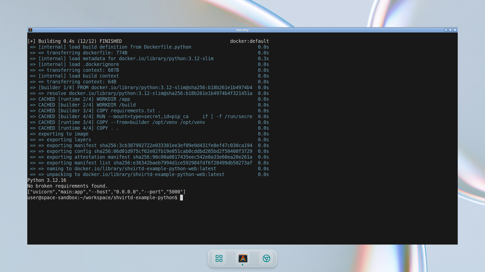
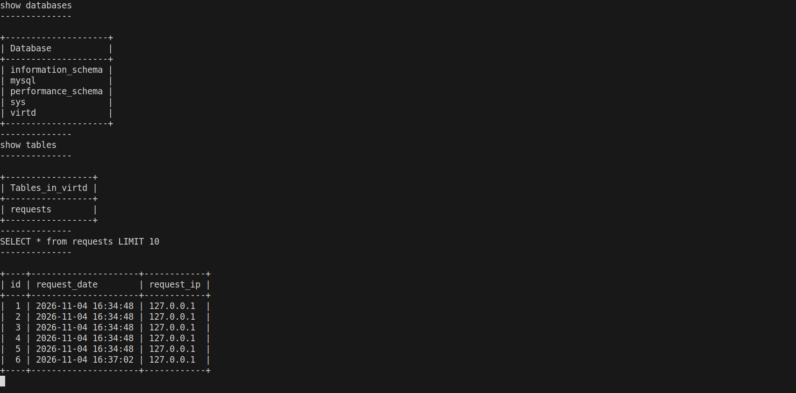
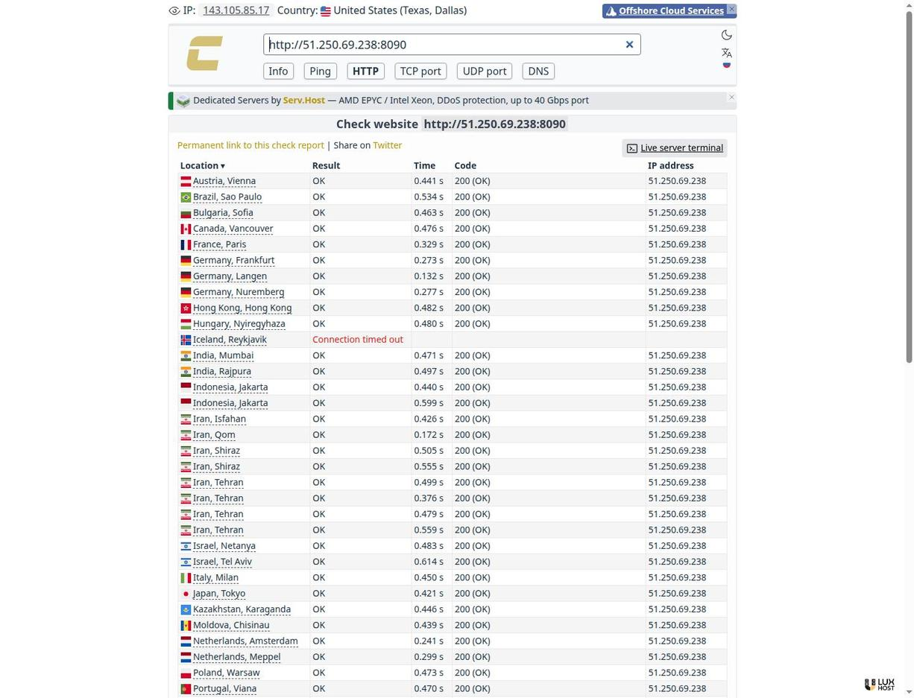
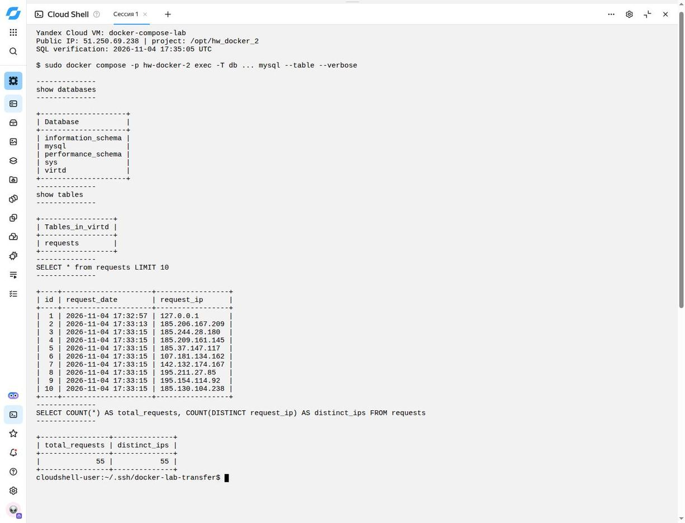
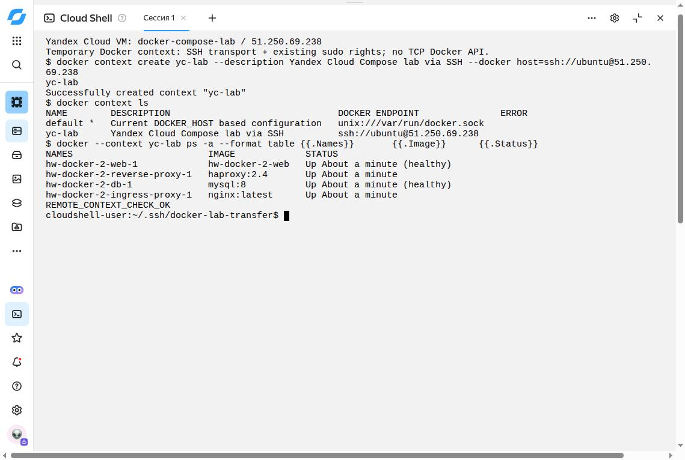
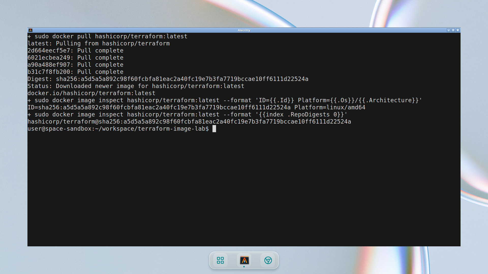
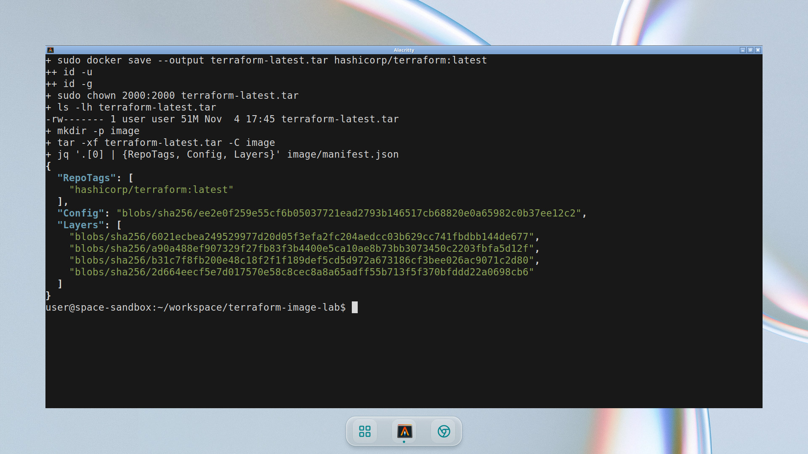
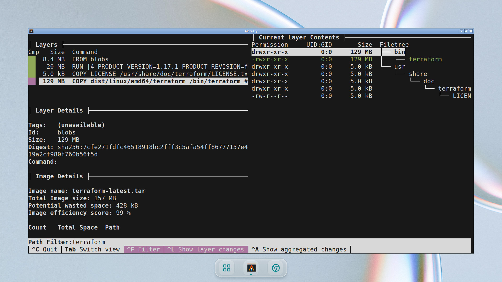
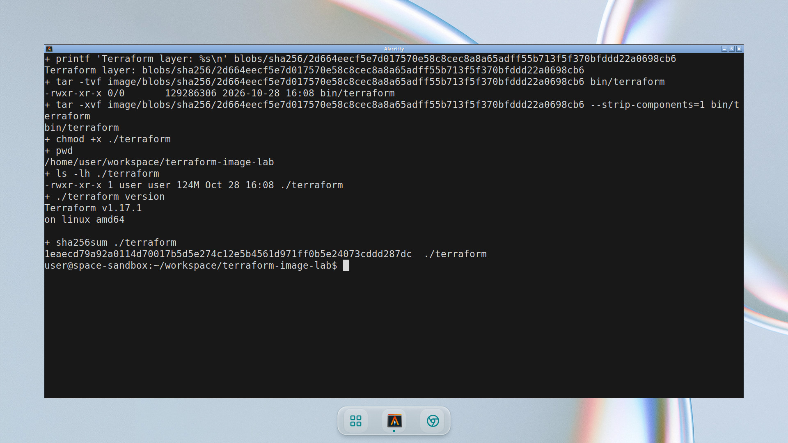

# ДЗ "Практическое применение Docker" Борис Горелик

## Задание 1

Создан [Dockerfile.python](Dockerfile.python) с двумя стадиями `builder` и `runtime` на основе `python:3.12-slim`. Зависимости устанавливаются в виртуальное окружение на первой стадии, затем окружение копируется в финальный образ вместе с исходным кодом приложения.

```dockerfile
FROM python:3.12-slim AS builder

ENV PIP_DISABLE_PIP_VERSION_CHECK=1
WORKDIR /build

COPY requirements.txt .
RUN --mount=type=secret,id=pip_ca \
    if [ -f /run/secrets/pip_ca ]; then export PIP_CERT=/run/secrets/pip_ca; fi \
    && python -m venv /opt/venv \
    && /opt/venv/bin/pip install --no-cache-dir -r requirements.txt

FROM python:3.12-slim AS runtime

ENV PATH="/opt/venv/bin:$PATH" \
    PYTHONDONTWRITEBYTECODE=1 \
    PYTHONUNBUFFERED=1

WORKDIR /app
COPY --from=builder /opt/venv /opt/venv
COPY . .

EXPOSE 5000
CMD ["uvicorn", "main:app", "--host", "0.0.0.0", "--port", "5000"]
```

Создан [.dockerignore](.dockerignore), исключающий `.env`, Git-метаданные, виртуальные окружения, кэш Python, документацию, скриншоты и другие файлы, не нужные приложению. Обязательные `COPY . .` и команда запуска Uvicorn сохранены.



## Задание 3
Создан [compose.yaml](compose.yaml), который подключает [proxy.yaml](proxy.yaml) директивой `include`. Включённый файл содержит оба прокси и bridge-сеть с точным именем `backend`.

- **web:** сборка из `Dockerfile.python`, адрес `172.20.0.5`, `restart: always`.
- **db:** образ `mysql:8`, адрес `172.20.0.10`, `restart: on-failure`, постоянный том `mysql_data`.
- **Подключение к БД:** `DB_HOST=db`; имя базы, пользователь и пароли подставляются из существующего `.env`, без публикации реальных секретов.
- **Готовность сервисов:** приложение запускается после успешного healthcheck MySQL.

```yaml
include:
  - proxy.yaml
```

Запуск и HTTP-проверка:

```bash
sudo docker compose config --quiet
sudo docker compose up -d --build --wait --wait-timeout 240
sudo docker compose ps
curl -L http://127.0.0.1:8090
```

Подключение к MySQL без печати пароля в командной строке хоста:

```bash
DB_CONTAINER=$(sudo docker compose ps -q db)
sudo docker exec -ti "$DB_CONTAINER" \
  sh -c 'exec mysql -uroot -p"$MYSQL_ROOT_PASSWORD"'
```

В клиенте MySQL выполнены команды:

```sql
show databases;
use virtd;
show tables;
SELECT * from requests LIMIT 10;
```



После сохранения скриншота локальный проект остановлен командой `docker compose down`. Отдельная проверка `docker compose ps -a` при подготовке этого отчёта также показала отсутствие контейнеров локального проекта; том базы данных не удалялся.

## Задание 4

Создана ВМ `docker-compose-lab`: Ubuntu 24.04 LTS, 2 vCPU, 2 ГиБ RAM и диск 20 ГиБ, зона `ru-central1-a`. В ходе выполнения задания внешний IP был `51.250.69.238`; подключение по SSH и установка Docker выполнены через Yandex Cloud Shell.

Подготовлен [scripts/deploy-yc.sh](scripts/deploy-yc.sh), который устанавливает Docker при его отсутствии, клонирует fork в `/opt/hw_docker_2` и запускает весь Compose-проект. При первом развёртывании примерные пароли из существующего `.env` заменяются случайными локальными значениями; реальные пароли не коммитятся и не показываются на скриншотах.

Команды запуска на Ubuntu-ВМ:

```bash
curl --fail --silent --show-error --location \
  https://raw.githubusercontent.com/brg171171/hw_docker_2/main/scripts/deploy-yc.sh \
  --output /tmp/deploy-yc.sh

### Проверка HTTP извне



### SQL на облачной ВМ

На сервере повторены запросы к базе `virtd`:

```sql
show databases;
use virtd;
show tables;
SELECT * from requests LIMIT 10;
SELECT COUNT(*) AS total_requests,
       COUNT(DISTINCT request_ip) AS distinct_ips
FROM requests;
```



### Docker SSH context



После демонстрации временный context, копия SSH-ключа в Cloud Shell и временные правила SSH-доступа удалены. Облачная ВМ по согласованию оставлена работающей; требование остановить проект в задании 2 относится к локальному запуску, а не к облачной ВМ.

## Задание 6

### Скачивание и сохранение образа





### Поиск слоя в dive



### Извлечение файла и проверка


